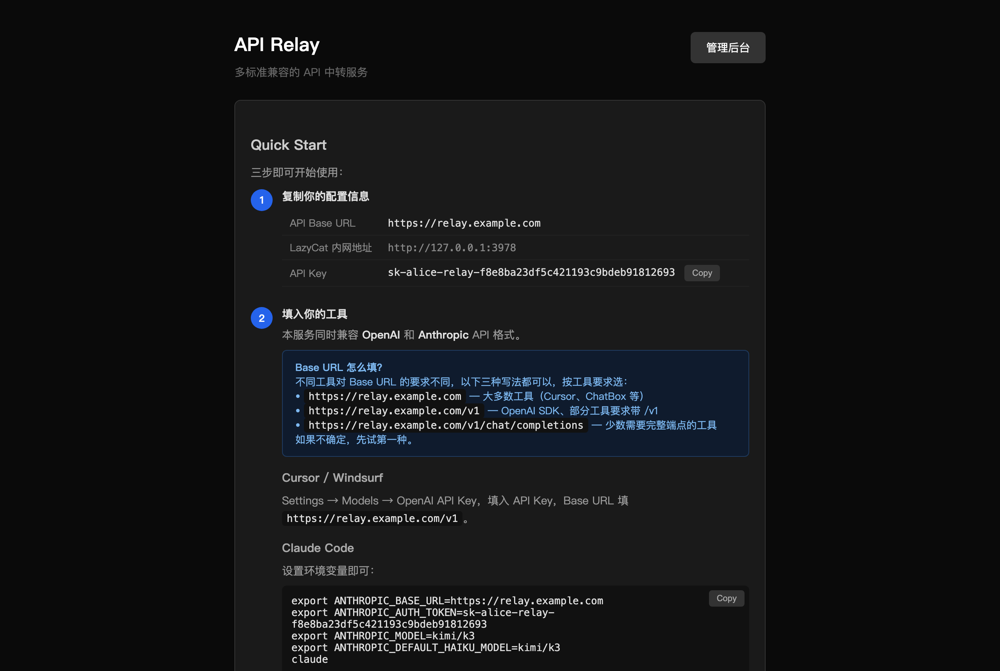

# API Relay

一个地址、一把 key，统一使用你所有的 AI 编程套餐。

把多家上游（Kimi、火山方舟、智谱……）的多把 key 汇到一起，对外提供编程 agent 需要的标准接口。key 出问题自动换下一把，模型列表自动与上游同步，不需要手动维护模型映射。

Rust 单二进制 + SQLite，可以独立运行，也可以打包成懒猫微服应用。



## 功能

- **编程 agent 需要的接口都支持**，原样转发给上游，流式输出和工具调用不受影响：

  | 接口 | 用途 |
  |---|---|
  | `POST /v1/messages` | Anthropic 格式（Claude Code、pi） |
  | `POST /v1/messages/count_tokens` | Anthropic token 计数（Claude Code） |
  | `POST /v1/chat/completions` | OpenAI 格式（Cursor、Cline、opencode、Aider） |
  | `POST /v1/responses` | OpenAI Responses 格式（Codex） |
  | `GET /v1/models` | 模型列表 |
  | `/v1/images/generations`、`/v1/videos/generations`、`/v1/files` | 图片、视频生成和文件上传 |

- **key 池**：一直用优先级最高的那把 key，出问题才换。这样上游的提示缓存不会因为换账号而失效。出问题的 key 会冷却一段时间：

  | 上游返回 | 冷却 |
  |---|---|
  | 429 限流 | 按上游 `Retry-After`，没有就 60 秒（最长 10 分钟） |
  | 401 / 402 / 403（key 失效、欠费） | 10 分钟 |
  | 502 / 503 / 504、网络错误 | 10 秒 |

  换 key 在同一个请求里完成，客户端无感。所有 key 都在冷却时，仍会按顺序再试一遍。

- **模型自动同步**：每 10 分钟从各上游的 `/models` 拉一次列表；后台改了服务商或 key 立即重拉；请求了目录里没有的模型也会马上重拉。上游没有 `/models` 接口的，在后台手动填模型名。

- **多用户**：每人一把 key（形如 `sk-<用户名>-relay-<随机串>`），各自的用量统计和每日限额。

- **服务商并发上限**：每个服务商可以设最多同时转发多少个请求。超出的请求排队等空位，不直接失败；等太久（默认 120 秒）才返回 429。

- **请求追溯**：客户端用 `X-Octo-Actor`、`X-Octo-Task`、`X-Octo-Run` 头标明"谁、为哪个任务、第几轮"，随用量记录一起存下，后台可按这些字段查询和导出 CSV。还可以把请求体和响应体存到磁盘，供事后分析。见[多 agent 集群](#多-agent-集群octoloop)。

## 模型名

模型名就是 `<服务商名>/<上游模型 id>`，例如 `kimi/k3`、`zhipu/glm-5.3`、`ark/ark-code-latest`。只有一家服务商提供某个模型时，可以省略前缀直接写 `k3`。

完整列表见 `GET /v1/models` 或管理后台的 Models 页。

## 配置上游

在管理后台 `/admin` 的 Providers 页添加服务商，再点 Keys 添加 key。

| 字段 | 说明 |
|---|---|
| OpenAI Base URL | OpenAI 格式接口的前缀，到 `/v1` 为止。`/chat/completions`、`/responses`、`/models` 接在它后面 |
| Anthropic Base URL | 可选。`/v1/messages` 接在它后面。不填时用 OpenAI Base URL 去掉末尾的 `/v1` |
| Extra Models | 可选。上游没有 `/models` 接口时，在这里手动列出模型名，逗号分隔 |
| User-Agent | 发给上游的 User-Agent，部分编程套餐会校验 |
| Max concurrency | 可选。最多同时有几个请求发往这个服务商，不填表示不限。列表里显示"在途 / 上限"，点 Edit 修改 |

几家常见上游的地址：

| 服务商 | OpenAI Base URL | Anthropic Base URL | Extra Models |
|---|---|---|---|
| Kimi Coding | `https://api.kimi.com/coding/v1` | 不填 | 不填 |
| 火山方舟 Plan | `https://ark.cn-beijing.volces.com/api/plan/v3` | `https://ark.cn-beijing.volces.com/api/plan` | `ark-code-latest` |
| 智谱 Coding | `https://api.z.ai/api/coding/paas/v4` | `https://api.z.ai/api/anthropic` | 不填 |

同一个服务商下的多把 key 按 Priority 从小到大使用。

## 客户端配置

下面用 `https://relay.example.com` 代表你的 relay 地址，`sk-you-relay-xxx` 代表你的 key。

### pi

把 [`clients/pi/relay.ts`](clients/pi/relay.ts) 复制到 `~/.pi/agent/extensions/`，再写 `~/.pi/agent/relay.json`：

```json
{ "baseUrl": "https://relay.example.com", "apiKey": "sk-you-relay-xxx" }
```

pi 启动和打开模型选择器时会从 relay 拉取模型列表，不需要改 `models.json`。relay 连不上时用上次缓存的列表。

### Claude Code

```bash
export ANTHROPIC_BASE_URL=https://relay.example.com
export ANTHROPIC_AUTH_TOKEN=sk-you-relay-xxx
export ANTHROPIC_MODEL=kimi/k3
export ANTHROPIC_DEFAULT_HAIKU_MODEL=kimi/k3
```

最后一行必须设：Claude Code 做小任务时会请求 `claude-haiku-*`，relay 不认识这个名字。

### Codex

`~/.codex/config.toml`：

```toml
model = "kimi/k3"
model_provider = "relay"

[model_providers.relay]
base_url = "https://relay.example.com/v1"
wire_api = "responses"
env_key = "RELAY_KEY"
```

注意不是每家上游都支持 Responses 接口（例如智谱不支持）。

### OpenAI 兼容工具（Cursor、Cline、Cherry Studio……）

Base URL 填 `https://relay.example.com/v1`，key 填你的 relay key，模型填 `kimi/k3` 这样的模型名。

## 用户和限额

- **限额**在后台 Limits 页设置：选用户、模型、时间窗口（最近 5 小时 / 1 天 / 1 周，滚动计算），再填最多多少次请求、多少 token。模型填完整模型名（如 `ark/ark-code-latest`）只限这一个模型，填 `*` 限全部；写错的模型名会被拒绝。留空表示不限，填 `0` 表示禁用。超出返回 429。
- token 包括缓存命中的输入，流式请求也会记录。Limits 页会显示每条限额在当前窗口里已经用了多少。
- 限额检查和记录在同一把锁里完成，并发请求不能超出限额。
- 没设限额的用户不限量。所有用户共用同一组上游 key。
- 管理后台的 Keys 列表会显示每把 key 在上游的 5 小时 / 每周额度用了多少（目前支持 Kimi 和智谱），可以用来估算"一把 key 的额度相当于多少 token"。

## 多 agent 集群（octoloop）

几十个 agent 同时跑时，relay 可以当整个集群的统一模型出口：限住每个服务商的并发，并记下每个请求是谁发的。

### 每个署名一个用户

每个 agent 署名（如 `lane-m07-a`、`m07-ver`、`outer`）在 Users 页建一个同名用户，用它自己的 key。这样用量、限额、key 吊销都按署名分开；某条车道失控时，只需在 Limits 页限它一个，或删掉这个用户。

### 服务商并发上限

编程套餐对单账号的并发很敏感，太多会被限流甚至封号。在 Providers 页给服务商填 Max concurrency（例如 Kimi 填 8）：

- 在途请求达到上限时，新请求排队，有空位就继续转发，客户端只是等得久一点。
- 排队超过 `RELAY_QUEUE_TIMEOUT_SECS`（默认 120 秒）返回 429，带 `Retry-After: 10`，不计入用户用量。Claude Code、Codex 收到 429 会自己退避重试。
- 流式请求在流结束或客户端断开时才让出名额；上游出错、所有 key 都失败时也会立即让出。
- 上限是按服务商算的，不是按 key：同一服务商下的多把 key 共用这个上限。改了上限立即生效，正在排队的请求也按新值算。

车道 profile 里再配好 fallbacks（例如 `kimi/k3` 之后是 `zhipu/glm-5.3`），一家排满时 agent 可以换另一家。

### 请求追溯头

| 请求头 | 含义 | 例子 |
|---|---|---|
| `X-Octo-Actor` | 署名 | `lane-m07-a` |
| `X-Octo-Task` | 任务 | `M07` |
| `X-Octo-Run` | 一次运行 | `2026-11-10-r3` |

这三个头存进用量记录的 `actor`、`task`、`run` 列，不会转发给上游。每个值最多 128 个字符，只保留可打印 ASCII 和常见中文，其余字符直接丢掉。不带这些头的请求照常转发，这几列为空。

Claude Code 用 `ANTHROPIC_CUSTOM_HEADERS`，多个头用换行分隔：

```bash
export ANTHROPIC_BASE_URL=https://relay.example.com
export ANTHROPIC_AUTH_TOKEN=sk-lane-m07-a-relay-xxx
export ANTHROPIC_MODEL=kimi/k3
export ANTHROPIC_DEFAULT_HAIKU_MODEL=kimi/k3
export ANTHROPIC_CUSTOM_HEADERS=$'X-Octo-Actor: lane-m07-a\nX-Octo-Task: M07\nX-Octo-Run: 2026-11-10-r3'
```

Codex 在 provider 里配 `http_headers`（固定值）或 `env_http_headers`（从环境变量取值，适合每轮都变的 task、run）：

```toml
[model_providers.relay]
base_url = "https://relay.example.com/v1"
wire_api = "responses"
env_key = "RELAY_KEY"
http_headers = { "X-Octo-Actor" = "m07-ver" }
env_http_headers = { "X-Octo-Task" = "OCTO_TASK", "X-Octo-Run" = "OCTO_RUN" }
```

### 查询和导出

管理后台 Usage 页可以按 Actor、Task 过滤今天的用量，Export CSV 导出最近 7 天的逐条记录。也可以直接调接口（需要管理员登录得到的 token，即 `/auth/login` 返回的 `token`）：

```bash
TOKEN=$(curl -s -X POST https://relay.example.com/auth/login -H 'Content-Type: application/json' \
  -d '{"username":"admin","password":"..."}' | jq -r .token)

# 逐条记录，JSON，默认最多 1000 条
curl -H "Authorization: Bearer $TOKEN" 'https://relay.example.com/admin/api/usage?actor=lane-m07-a&since=2026-11-10'
# CSV：id,created_at,user,model,input_tokens,output_tokens,actor,task,run，默认最多 10 万条
curl -H "Authorization: Bearer $TOKEN" 'https://relay.example.com/admin/api/usage/export?task=M07&since=2026-11-10T00:00:00Z' > usage.csv
```

参数都可选：`since`、`until`（UTC，`2026-11-10` 或 `2026-11-10T08:00:00Z` 这样的格式，写错返回 422）、`user`、`actor`、`task`、`run`、`limit`。`/admin/usage`（Usage 页的按天汇总）也接受 `actor`、`task`。

### 留存请求体（可选）

设了 `RELAY_CAPTURE_DIR` 后，每个成功的对话请求（`/v1/messages`、`/v1/chat/completions`、`/v1/responses`）都会存一份到 `<目录>/<UTC 日期>/<用量记录 id>.json.gz`，内容是：

- 客户端发来的请求体，和上游返回的响应体；流式响应是拼起来的 SSE 原文，单个响应最多存 32 MB，超出部分截掉并标记 `response_truncated`。
- 用户名、模型、服务商、状态码，以及 actor、task、run。

不存任何请求头，所以文件里没有 relay key 和上游 key。客户端断开时也会存下已收到的部分。写盘失败只记日志，不影响请求本身。被上游拒绝、排队超时的请求不存。

`RELAY_CAPTURE_SAMPLE` 设采样率（0–1，默认 1 即全部留存），例如 `0.1` 只存一成。留存的是对话原文，可能含代码和隐私信息，请控制目录权限并定期清理，例如 `find "$RELAY_CAPTURE_DIR" -mindepth 1 -maxdepth 1 -mtime +14 -exec rm -rf {} +`。

读取：`gzip -dc 2026-11-10/1234.json.gz | jq .`

## 部署

### 懒猫微服

```bash
lzc-cli project build                       # 交叉编译并打出 .lpk
lzc-cli app install ./bh3gei.lzcapp.api-relay-v*.lpk
```

`lzc-cli app install` 需要微服上装有「懒猫开发者工具」。没装的话，可以把 `.lpk` 拷到微服上用系统自带的 `lpk-manager install <文件>` 安装。

交叉编译需要 Rust 的 `x86_64-unknown-linux-musl` target 和 musl 交叉编译器（macOS：`brew install filosottile/musl-cross/musl-cross`），见 [`lazycat/build.sh`](lazycat/build.sh)。

懒猫模式下：

- **免密登录**：用懒猫账号直接登录，不需要密码。懒猫管理员第一次打开时自动建号并成为 relay 管理员；普通用户需要管理员先在 Users 页添加同名用户（密码留空）才能使用。管理员身份每次登录都按懒猫里的角色同步。
- **只有 `/v1/` 不经过懒猫登录**（`public_path`），由 relay 自己校验 key。首页、管理后台、登录接口都需要先登录懒猫。
- 数据库在 `/lzcapp/var/relay.db`，重启和升级都不会丢。

### 公网访问（Cloudflare Tunnel）

懒猫的 `*.heiyu.space` 域名只在懒猫虚拟网络里能解析。要让没装懒猫客户端的人也能用，可以开 Cloudflare Tunnel：

1. 创建隧道并绑定域名，任选一种：
   - 命令行：`cloudflared tunnel create api-relay`，`cloudflared tunnel route dns api-relay relay.example.com`，再用 `cloudflared tunnel token api-relay` 取出 token。
   - Cloudflare 后台：Zero Trust → Networks → Tunnels 创建隧道，复制 token，并添加 Public Hostname，服务填 `http://localhost:3001`。
2. 在管理后台 Public Access 页填入 token，点 Save & connect；再把公网地址（如 `https://relay.example.com`）填进 Public URL，首页的配置示例就会显示这个地址。

隧道只连到 relay 的公网专用端口（`PUBLIC_BIND_ADDR`，懒猫包里是 `127.0.0.1:3001`），这个端口只提供 `/v1/…` 接口：首页、管理后台和 `/auth` 都不在上面，因为它们信任懒猫网关注入的身份头，绕过网关就能被伪造。公网端口的防暴力破解按 Cloudflare 的 `CF-Connecting-IP` 计算。

`cloudflared` 随懒猫包一起打包（版本和校验值固定在 `lazycat/build.sh` 里），由 relay 启动和管理：断开会自动重连，token 通过环境变量传入，不出现在进程参数里。

### 独立运行

```bash
cargo build --release
DATABASE_URL="sqlite:relay.db?mode=rwc" BIND_ADDR=127.0.0.1:3000 ./target/release/api-relay
```

打开首页注册第一个账号，它就是管理员；之后注册入口关闭，其他用户由管理员在后台添加。

| 环境变量 | 默认值 | 说明 |
|---|---|---|
| `DATABASE_URL` | `sqlite:relay.db?mode=rwc` | SQLite 数据库 |
| `BIND_ADDR` | `0.0.0.0:3000` | 监听地址 |
| `JWT_SECRET` | 首次启动时生成并存入数据库 | 网页登录的签名密钥 |
| `PUBLIC_BIND_ADDR` | 不设 | 公网专用端口，只提供 API，给隧道用 |
| `CLOUDFLARED_PATH` | 不设 | cloudflared 程序路径；同时设了 `PUBLIC_BIND_ADDR` 才会启用 Public Access |
| `LAZYCAT` | 不设 | 设为 `1` 时信任懒猫网关注入的身份头。**只能在懒猫网关后面设置**，否则任何人都能伪造身份 |
| `RELAY_QUEUE_TIMEOUT_SECS` | `120` | 服务商并发已满时，请求最多排队多少秒，超时返回 429 |
| `RELAY_CAPTURE_DIR` | 不设 | 留存请求体和响应体的目录；不设就不留存 |
| `RELAY_CAPTURE_SAMPLE` | `1` | 留存采样率，0–1 |

对外提供服务时请放在 HTTPS 反向代理后面。

## 安全

- 未带有效 key 的 API 请求在读取请求体之前就被拒绝，不能用大请求体耗尽内存。
- 同一个地址 10 分钟内认证失败 10 次会被暂时封禁，失败会记录日志（地址取反向代理加在 `X-Forwarded-For` 最后的那一项）。
- 完整的上游 key 从不发给浏览器，管理接口里只有最后 4 位；页面上的数据都会转义。
- 所有 key 都失败时返回统一的错误，不透传上游的错误内容；不跟随上游重定向。
- `/v1/files` 只有管理员能用（所有用户共用一个上游账号，否则能看到彼此的文件）。
- 管理接口每次都会查数据库确认管理员身份，撤销的管理员即使 token 没过期也无法继续操作。
- 文件接口校验 file id，防止路径穿越到上游的其他接口。
- 日志里的 key 只显示最后 4 位。
- relay key 泄露时，在首页点 Regenerate Key 换一把新的，旧 key 立即失效。

## 许可证

MIT，见 [LICENSE](LICENSE)。懒猫包里附带的 cloudflared 使用 Apache-2.0 许可，见 [lazycat/cloudflared.LICENSE](lazycat/cloudflared.LICENSE)。
